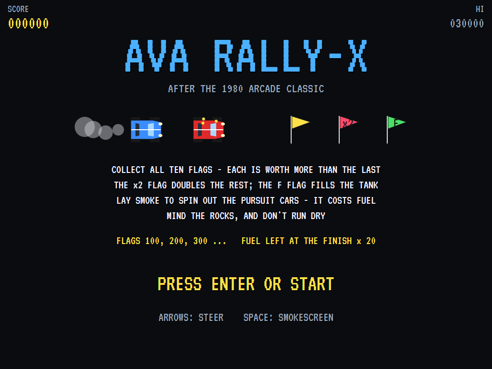
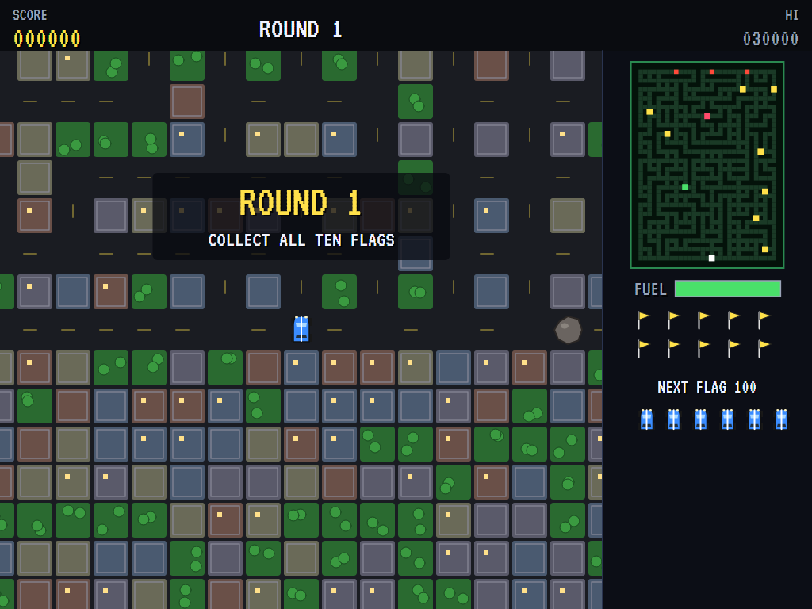
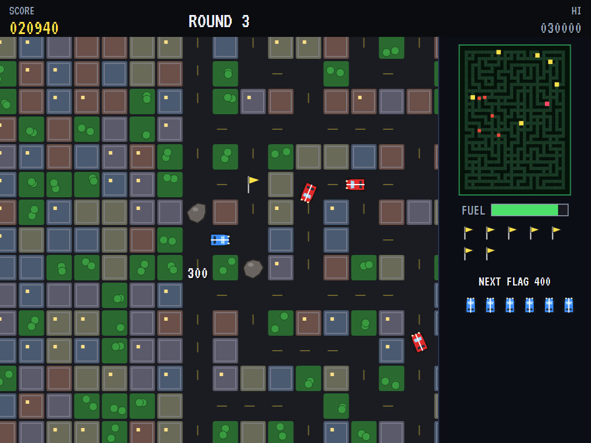
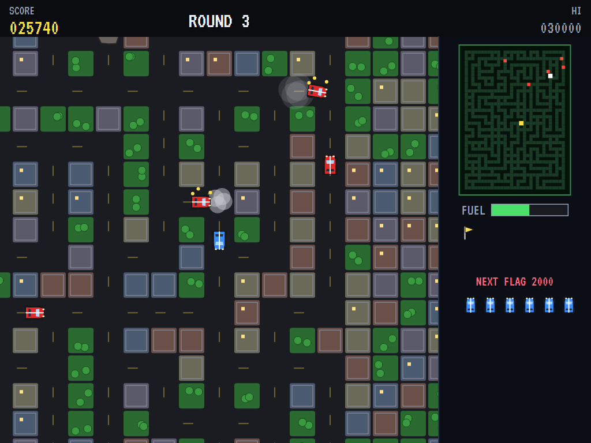
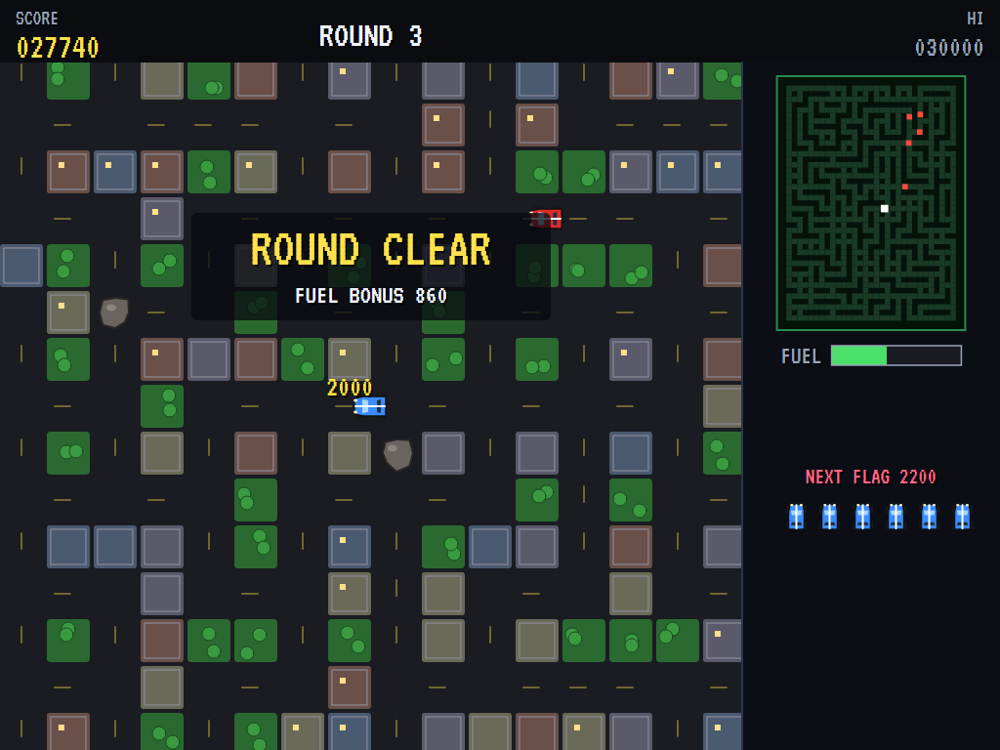
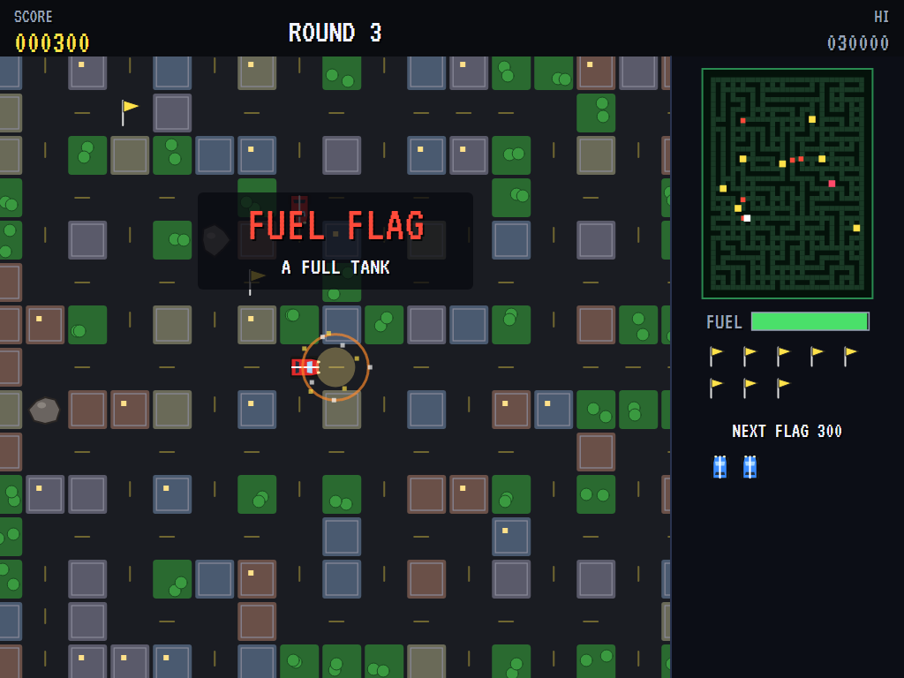
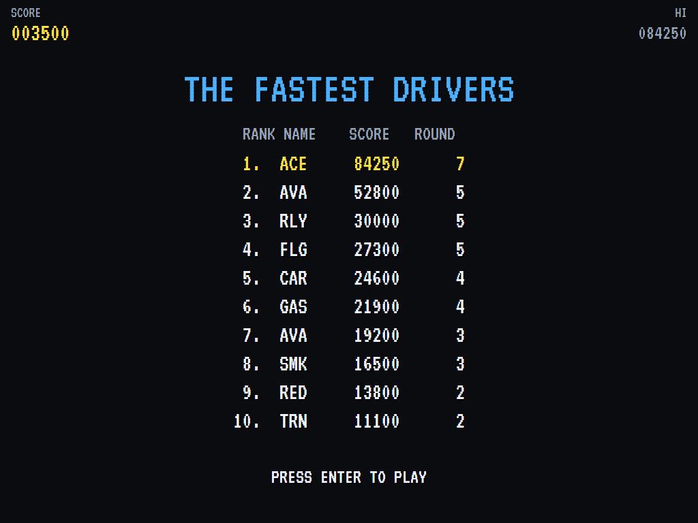

# AVA Rally-X

[](https://github.com/Harlock123/AVARallyX/actions/workflows/build.yml)

A maze-racing flag hunt in the style of Namco's 1980 arcade game **Rally-X**, built with .NET 10 and
Avalonia UI. Race a blue rally car round a big scrolling maze of city streets collecting ten flags, while red
pursuit cars hunt you down. Lay a smokescreen to spin them out, but every puff burns fuel, and you can't
afford to run dry.

## Features

- **The course**: a new maze of city streets each round, a little bigger than the screen.
  - **The streets:** cross streets everywhere, so there's always another way round, and no dead ends.
  - **Hazards and flags:** rocks lie on the roads, and the flags are scattered far and wide.
  - **The radar:** on the panel it shows the whole course, every flag and every car.
- **The car**:
  - **Steering:** it never stops. At each junction it takes the way you're pointing, and otherwise drives on, turning itself round bends. Push back the way you came and it turns round at once.
  - **Smokescreen:** the button leaves a puff of smoke behind. A pursuer that drives into it spins out for a few seconds, harmless. Each puff costs fuel.
- **Flags**: ten to a round. Each is worth more than the one before: 100, 200, 300 and so on.
  - **The ×2 flag:** doubles every flag after it.
  - **The F flag:** fills the tank.
  - **Finishing a round:** take them all and whatever fuel is left counts up as a bonus.
- **Fuel**: it burns away as you drive. Run dry and the car crawls, easy prey. A new car comes with a full tank.
- **The pursuers**: red cars that start at the top of the course and hunt the car through the streets, usually by the shortest way, now and then not. More come each round, and quicker.
- **Rocks**: run into one and that's the car.
- **Scoring**: flags as above, fuel left × 20 at the end of a round, and an extra car at 20,000 and every 50,000 after that.
- **Sound**:
  - **The music:** a bustling rally march for the race and a breezy tune for the title, both new.
  - **The effects:** chimes for the flags, the smokescreen, pursuers spinning out, fuel warnings, the bonus counting up, and crashes.
  - All of it is synthesised and mixed by OpenAL.
- **Attract mode**: leave the title alone for 15 seconds and a computer driver plays.
  - **Planning:** it plans the cheapest way to each flag, where streets near a pursuer cost dear, and it is drawn to the ×2 and fuel flags when they're worth it.
  - **Smoke:** it lays smoke when a pursuer gets close behind.
- **A top-ten high-score table** with arcade-style initials entry. It records the round reached.
- **Gamepads** through SDL2, as well as the keyboard.
- **Any window size**: the screen scales to fit, letterboxed. **Ctrl+S** saves a screenshot.
- **One self-contained executable** per platform: Windows, macOS and Linux on Intel/AMD and ARM.

## Screenshots

| The title | Round 1 | The chase |
|:---------:|:-------:|:---------:|
|  |  |  |
| Flags, smoke and pursuers. | On the grid. | Pursuers closing in. |

| Smoke | Round clear | A crash |
|:-----:|:-----------:|:-------:|
|  |  |  |
| Two pursuers spun out. | The fuel bonus. | Caught. |

| The fastest drivers | | |
|:-------------------:|:-:|:-:|
|  | | |
| The high-score table. | | |

The screenshots are made by the tests, which play the game in a real (headless) window; see
[Tests](#tests).

## Download and run

Ready-to-run builds for Windows, macOS and Linux, on both Intel/AMD and ARM, are on the
[Releases page](https://github.com/Harlock123/AVARallyX/releases/tag/latest). **Latest build** is rebuilt
on every push to `main`. Each download is one self-contained executable: no .NET install is needed.

| Platform | Archive |
|---|---|
| Windows | `AVARallyX-win-x64.zip`, `AVARallyX-win-x86.zip`, `AVARallyX-win-arm64.zip` |
| macOS | `AVARallyX-osx-arm64.tar.gz` (Apple silicon), `AVARallyX-osx-x64.tar.gz` (Intel) |
| Linux | `AVARallyX-linux-x64.tar.gz`, `AVARallyX-linux-arm64.tar.gz`, `AVARallyX-linux-arm.tar.gz` |

```bash
tar -xzf AVARallyX-linux-x64.tar.gz     # or linux-arm64, linux-arm, osx-arm64, osx-x64
./AVARallyX
```

On Windows, unzip and run `AVARallyX.exe`. On macOS, if Gatekeeper refuses to open it, run
`xattr -d com.apple.quarantine AVARallyX` once. Run with `--no-audio` for silence.

**Sound** comes through OpenAL Soft, built in for every platform. In a virtual machine the game
detects it and uses a larger audio buffer, so the sound doesn't break up.

**Gamepads** use SDL2, which is bundled for Windows, macOS and Intel/AMD Linux. ARM Linux builds need it
installed; without it the keyboard still works:

```bash
sudo apt install libsdl2-dev            # Debian / Ubuntu / Raspberry Pi OS
sudo pacman -S --needed sdl2-compat     # Arch / Omarchy
```

## Controls

| Input | Action |
|-------|--------|
| **Enter** | Start |
| **Arrow keys** / **W A S D** (or the numeric keypad) | Steer: the car takes the way you point at the next junction |
| **Space** / **Z** / **X** / **Ctrl** | Smokescreen (hold to keep laying it) |
| **P** / **Esc** | Pause (Esc again to quit) |
| **M** | Mute |
| **Ctrl+S** / **Cmd+S** | Save a screenshot to the Pictures folder |

**Gamepad**: left stick or D-pad to steer, **A**, **B** or **X** for smoke, **Start** to start and pause,
**Back** (while paused) to quit.

**Entering initials**: type letters, or dial with **Up**/**Down** and accept with **Space**; **Left** /
**Backspace** go back; **Enter** finishes.

## Tests

```bash
dotnet test AVARallyX.slnx
```

The engine has no UI and runs in fixed 60 Hz steps, so it plays the same at any frame rate, and a seed
always plays the same game. The tests check:

- **The course:** every one joined up and walled in, with ten flags (one ×2, one fuel) all reachable past the rocks, and the right number of rocks and pursuers each round
- **The car:**
  - never stopping, and taking the turn the stick points
  - turning itself at a bend, and turning round at once
- **Flags and fuel:**
  - each flag worth more than the last, the ×2 flag doubling the rest, and the fuel flag filling the tank
  - the last flag clearing the round and the fuel counting up as a bonus
  - fuel burning, and an empty tank slowing the car
- **Smoke and pursuers:**
  - smoke costing fuel and spinning out a pursuer
  - pursuers closing in, and a crash bringing the next car out at the start with a full tank
  - rocks, and the last car ending the game
- **The machine:** an extra car, the computer driver clearing the first rounds, the attract cycle, the same game from the same seed, initials and the high-score file

The screenshot tests draw the real screen in a headless window. To refresh the README's pictures:

```bash
RALLY_SHOTS=$PWD/Images dotnet test tests/AVARallyX.Tests --filter ScreenshotTests
```

To see how the computer driver gets on, round by round (for tuning):

```bash
RALLY_PROBE=1 dotnet test tests/AVARallyX.Tests --filter PilotProbe --logger "console;verbosity=detailed"
```

## Building

```bash
dotnet build AVARallyX.slnx
dotnet run --project src/AVARallyX
```

Needs the .NET 10 SDK. The sounds are made by `tools/make_sounds.py` (standard-library Python):
`python3 tools/make_sounds.py` rewrites `src/AVARallyX/Sounds`.

## Project structure

```
AVARallyX/
├── AVARallyX.slnx
├── src/AVARallyX/
│   ├── Engine/
│   │   ├── GameEngine.cs        # States, the title and demo cycle, and the music
│   │   ├── GameEngine.Play.cs   # The car, flags and fuel, the smokescreen, the pursuers, rocks,
│   │   │                        # rounds and scoring
│   │   ├── Course.cs            # Each round's maze of streets; distances through it
│   │   ├── RallyPilot.cs        # The computer driver, for the demonstration (and the tests)
│   │   ├── Entities.cs
│   │   ├── HighScoreTable.cs, InitialsEntry.cs
│   │   ├── InputHandler.cs, ControllerManager.cs  # Keys and an SDL2 gamepad
│   │   └── SoundManager.cs      # Effects and the tunes through OpenAL
│   ├── Audio/                   # The OpenAL engine (from the author's AVABand)
│   ├── Views/                   # Streets and city blocks, the cars, flags, rocks and smoke, the radar panel
│   └── Sounds/                  # The synthesised effects and tunes
├── tests/AVARallyX.Tests/       # Gameplay, screenshot and probe tests
├── tools/make_sounds.py
└── Images/                      # Screenshots
```

## About and licence

AVA Rally-X © 2026 Lonnie Watson, under the [MIT License](LICENSE).

*Rally-X* © 1980 Namco (now Bandai Namco); the name belongs to its current owner. AVA Rally-X is an
independent, unofficial game in its style. Its cars, courses, flags, graphics, sounds, tunes and code are
its own; nothing is taken from the arcade machine's program, graphics, sound or music. It is not affiliated
with or endorsed by any rights holder.
